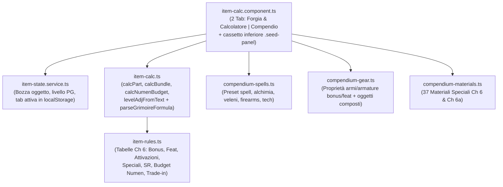

# Piano Definitivo — Calcolatore e Forgia Oggetti Magici (`MagicItem`)

> [!IMPORTANT]
> Piano aggiornato con tutti i miglioramenti concordati. Puoi provare subito il nuovo flusso nel mock-up aggiornato: [mockup-oggetti.html](./mockup-oggetti.html) (ora in stile **Pergamena & Ceralacca** fedele a `styles.css`, a **2 sole tab**, con modifica `✎`, cassetto regole inferiore, sinergia metamagica, scomposizione Grimoire, dosi vs scorta `×18` e barra Numen a 4 fasce).

---

## 1. Architettura modulare (`src/app/items/`)

Unifichiamo i vecchi `ItemPreset` e `CompositeItem` in un unico modello **`CompendiumItem`** basato su **`ItemPart[]`** (un oggetto a singola spell o singola proprietà è semplicemente un `CompendiumItem` con 1 parte).

| File | Ruolo |
|---|---|
| `src/app/items/item-rules.ts` | Costanti e tabelle ufficiali di *Ch 6* / *Ch 6a*: Enhancement Bonuses, Other Numerical Bonuses, modalità Feats, attivazioni/durate/usi Spell, formule Speciali/Other (distinguendo *Amulet of SR* da *Cold Iron*), tabella Numen (`Min`/`Par`/`Overflow`/`Max` liv. 1–20), tabella Trade-in (`+1..+9`). |
| `src/app/items/item-calc.ts` | Motore puro: union discriminata `ItemPart` (`bonus` \| `spell` \| `feat` \| `material` \| `special` \| `fixed`), `calcPart()`, `calcBundle()`, `calcNumenBudget()` (con *CR −1* sotto `Min` e *Floating Inventory* tra `Min` e `Par`), `applyMetamagicSynergy()`, `levelAdjFromText()` fixato e parser delle 3.445 formule del Grimoire (*Ch 8a*). |
| `src/app/items/compendium-spells.ts` | Voci a base incantesimo/alchimia/veleni/firearms/tech di *Ch 6* e *Ch 6a* ripulite e completate nel formato unificato `CompendiumItem`. |
| `src/app/items/compendium-gear.ts` | Proprietà di armi/armature basate su bonus numerici o talenti (*Keen*, *Vorpal*, *Shadow*, *Defending*, *Wild Armor*, *Spellcrashing*, ecc.) + tutti gli oggetti multi-parte (*Holy Avenger*, *Dwarven Thrower*, *Murderer's Blackcloth*, *Staff of Fire*, *Rod of Force*, *Decanter*, *Frost Brand*, *Staff of the Serpent*, *Undercutting Axe*, *Healing*, *Jarring*, *Righteous*, *Stun Baton*, ecc.). |
| `src/app/items/compendium-materials.ts` | Tutti i **37 Materiali Speciali** (*11 Ch 6* + *26 Ch 6a*) con varianti per supporto (Arma, Armatura Leggera/Media/Pesante, Scudo). |
| `src/app/items/item-state.service.ts` | Persistenza in `localStorage` della bozza in lavorazione (nome, livello PG, parti, stato `on`) per non perdere il lavoro navigando tra i documenti. |
| `src/app/items/item-calc.component.ts` | Pagina `/oggetti` ristrutturata a **2 sole tab** (`.chips`), design system nativo di `styles.css` e cassetto inferiore `.seed-panel` condiviso con `LookupService`. |
| `src/app/custom-entries.ts` | Aggiunta di `Location-Specific Spell [Metamagic]` (`-2`) e `Object-Specific Spell [Metamagic]` (`-2`). |

*(I vecchi file piatti `src/app/item-calc.ts`, `item-presets.ts`, `item-composite.ts`, `item-calc.component.ts` verranno sostituiti dalla cartella `src/app/items/` aggiornando il lazy import in `src/app/app.routes.ts`.)*

---

## 2. Struttura UX (2 sole Tab + Cassetto Regole)

### Tab 1 — Forgia & Calcolatore (Oggetti + Spell)
- **Testata Oggetto, `Numen già in uso` & Barra Situazione Finale a 4 fasce**:
  - Campi: **Nome oggetto/spell**, **Livello PG (`1–20`)** e **`Numen già in uso`** (entrambi persistiti in `localStorage` così restano salvati tra una sessione e l'altra) + pulsanti **Copia riepilogo** e **Svuota**.
  - Mostra chiaramente **3 numeri**: `Già in uso` + `Questo oggetto` = **`Situazione finale`**.
  - **Barra grafica bicolore** (segmento base = *Numen già in uso*, segmento evidenziato = *+ Nuovo oggetto*) sulle 4 zone di *Ch 6* calcolate sul **totale finale**:
    1. **`< Min`**: avviso **`CR −1`** (*Minimal Gear*).
    2. **`Min → Par`**: entro *Par* + **Floating Inventory** residuo (`Par − totaleFinale`, max `10 gp × liv` per oggetto mondano).
    3. **`Par → Max`**: in *Overflow* (oggetti craftati o trovati).
    4. **`> Max`**: oltre il limite massimo vincolabile dal PG.
- **Pannello sinistro — Configuratore a 5 moduli (*Order of Operations*)**:
  1. **Bonus Numerici**: Enhancement Bundled (`Arma +1..+5`, `Armatura/Scudo +1..+10`), 14 Enhancement singoli (magici & masterwork), Other Numerical Bonuses (`Alchemical`, `Resistance`, `Deflection`, `Insight`, `Shield`, `Luck`, `Inherent`, `Other`) + moltiplicatore condizionale (`×1`, `×0,5`, `×0,25`, `×0,125`).
  2. **Effetto Spell / Alchimia *(integrato, senza cambiare tab!)***:
     - Mostra **in tempo reale** il risultato della singola spell/pozione/veleno (così chi vuole fare un calcolo singolo al volo ha già la risposta pronta!) **e** sotto il bottone **`+ Aggiungi all'oggetto`** (o **`Salva modifiche`** se si sta modificando una parte esistente).
     - **Selettore Spell**: tutti i 52 semi di *Ch 8* (inclusi i 4 semi divini/bardo come `Spark of Life` e `Remove Condition`) + le **3.445 spell del Grimoire (*Ch 8a*)** col livello già estratto e bottone **"Scomponi nei semi e metamagie"** + spell manuale (`0–9`).
     - **Metamagia (bidirezionale `+` / `−` e selettori di step)**:
       - Costi negativi e positivi letti correttamente dal manuale (`Tenuous = -1`, `Hide = +2`, `Location/Object-Specific = -2`).
       - Controlli rapidi **`−` / `+`** su ogni metamagia aggiunta + **mini-selettore contestuale degli step** per le metamagie bidirezionali/tabellari (*Reach Spell* da `-2` a `+8` es. `Close → Touch -1` o `Close → Long +2`; *Extend Spell* da `-4` a `+7`; *Shape Spell* da `-2` a `+3`; *Widen Spell* da `-2` a `+4`; *Augment* `-1..+4`; *Variable* `-1/+1`; *Reduce* `-1..-4`; *Specific/Ritual/Restricted* `-1/-2`).
       - Spunta opzionale **"Applica Sinergia Metamagica (*Ch 8*)"** (`-1` ai soli costi positivi `≥ +2` dopo il primo `≥ +1`, senza mai alterare costi `≤ 0`, e rispettando le eccezioni *Quicken + Silent/Still* e *Augment* sul cap danni).
     - **CL auto-suggerito**: aggiorna automaticamente `CL = max(1, 2 × livello − 1)` finché l'utente non imposta un CL manuale (con pulsantino `Auto` per riallinearlo).
     - **Separazione guidata tra Modalità Spell pura, Attivazione, Durata e Usi/giorno (*Ch 6*, *Ch 6a*, *Ch 8*)**:
       - **Solo Spell — creazione incantesimo (*Ch 8*, nessun moltiplicatore oggetto)**: trasforma la Forgia anche in **costruttore di incantesimi personalizzati**! Nasconde prezzo/durata/usi dell'oggetto e mostra:
         - **Livello finale dell'incantesimo** (`0°`–`9°`) + **CL minimo** (`max(1, 2×liv − 1)`).
         - **Formula formattata stile Grimoire (*Ch 8a*)** pronta da copiare per libro degli incantesimi o scheda (`Nome: Seme (liv) + Metamagia (+X) = N° livello`).
         - **CD Sapienza Magica (*Applying Metamagic*, Ch 8)**: `15 + liv. base + ∑(|costo|; +0 conta +1)` per applicarla in preparazione/spontaneamente (non richiesta se appresa/trascritta come *pre-modified spell*).
         - **Tempo extra preparazione (*Mitigating Metamagic*)**: `+1 ora` per ogni livello di riduzione da metamagie negative (non applicabili spontaneamente).
       - **Continuo (`1.000`, sempre attivo senza azione)** e **Uso attivato (`500`, attivo mentre impugni/usi)**: mostrano il selettore **Durata della spell** (`×8` istantaneo, `×6` 1 rd, `×4` 1 rd/liv, `×2` 1 min/liv, `×1,5` 10 min/liv, `×1` 1 hr/liv o `Contingente / [Strike]`, `×0,5` permanente); per il caso speciale **Continuo fino a scarica (*Continuous until discharged*, es. *Reflecting*, *Jarring*)** permettono di commutare su **Usi/giorno (`1..4/gg = ×0,2..×0,8`)** che in Kirthfinder sostituiscono il moltiplicatore di durata (con override manuale libero se serve combinare entrambi).
       - **A comando (`900`, richiede azione per attivare)**: disattiva il moltiplicatore di durata (ogni attivazione dura quanto un lancio della spell; per allungarla si usa *Extend Spell*) e mostra direttamente **Frequenza**: `A volontà (×1)` o `1–4 usi/giorno (×0,2..×0,8)`.
       - **Cariche / Staff / Tech (`750`, 10 cariche ricaricabili)**, **Pozione / Alchimia / Veleno (`50 gp`)**, **Pergamena / Scroll (`25 gp/numen` — *Ch 4 Knowledge: Linguistics*, metà di una pozione; CD creazione `15 + liv`, materiali metà prezzo, scorta a volontà `900 = ×36`)**, **Uso singolo / Munizione / Latente / Spell nel libro Mago (`50 numen`)**, **Masking latente (`25 numen`)**: moltiplicatore `×1` automatico (sbloccabile) + spunta opzionale **Effetto latente aggiuntivo (`+50 × liv × CL`)**.
     - **Gestione `gp` (Pozioni/Alchimia/Veleni)**: mostra sia `gp/dose` sia `Scorta privata (×18)` e, quando aggiungi all'oggetto, fa scegliere tra **`N` dosi singole (`1 gp = 1 numen`)** e **Scorta privata a volontà (`×18`)**.
  3. **Talento**: Standard (`2.000 × BAB/gradi` con ricerca da *Ch 5*), *Metamagic Rod* (`2.000 × CL min`, `2/gg` o `3/gg ×1,5`), Usi extra (`2.000 × liv`), Round extra (`2.000 + 1.000 × (r−1)`), *Non-metallic* (`8.000`), condizionale `×0,5`.
  4. **Materiale Speciale**: 37 materiali (*Ch 6* + *Ch 6a*) per supporto + generatore **Exotic Hide Armor** (CA naturale creatura).
  5. **Speciali & Altro**: Velocità (`+5 ft. × 250`), Resistenza energia (`×1.200` o `×1.000`), **SR separata** (*Amulet of SR*: `90.000` a SR 25 `± 10k/pt` o `132.000 ± 12k/pt` con *Amplify*; *Cold Iron*: `10k / 30k / 50k`), Fortification (`5% × 5.000`), Armi a energia/sonico/negativo/forza (`+1d6..+10d6`), *Power Conduits*, *Prepared Spell Slots*, *Embedded Item* (`14.000`), *Masking*, tabelle *Wild Armor* / *Force Field* / *Spellcrashing*, *Trade-in Enhancement* (`−6k..−84k`) e *Voce fissa manuale*.
- **Pannello destro — Componenti dell'oggetto**:
  - Lista interattiva con checkbox `conta`, badge categoria, formula leggibile, tasto **`?`** (apre la voce nel cassetto `.seed-panel`), tasto **`Modifica (✎)`** (ricarica la parte nel form a sinistra evidenziandola) e **`Rimuovi (✕)`**.

### Tab 2 — Compendio (*Ch 6 & 6a*)
- Ricerca testuale con debounce `120 ms` + filtro per categoria (`Tutti`, `Armi & Proprietà`, `Armature & Scudi`, `Oggetti Meravigliosi`, `Alchimia & Veleni`, `Armi da fuoco & Tech`, `Materiali Speciali`, `Composti`).
- Ogni scheda mostra parti, formula, totale calcolato vs totale stampato dal manuale (segnalando eventuali discrepanze del libro senza alterarlo), tasto **`?`** per leggere la regola e **`Carica nella Forgia`** per personalizzarlo.

### Aiuti contestuali a 2 livelli: Popover Hover (~350 ms) + Cassetto `.seed-panel`
1. **Finestrella Hover ritardata (~350 ms, + focus tastiera)**:
   - Tenendo il mouse sopra **concetti e parametri UI** (*Continuo*, *Uso attivato*, *A comando*, *Cariche/Tech*, *Contingente / [Strike]*, *Continuous until discharged*, *Effetto latente*, *Masking*, *Sinergia Metamagica*, *Bundled*, *Min / Par / Floating Inventory / Overflow / Max*, *Scorta privata ×18*) o sopra **voci di gioco** (spell, metamagie, talenti, materiali), compare una piccola card flottante non invasiva che spiega subito in poche righe cosa fa e come incide sul prezzo.
2. **Cassetto inferiore `.seed-panel` (al clic su `[?]`)**:
   - Riusa il pannello ridimensionabile di `DocComponent` per aprire il **testo integrale e le tabelle del manuale** (es. le tabelle *Da → A* di *Extend Spell*, *Reach Spell*, *Shape Spell*) tramite `LookupService` senza abbandonare `/oggetti`.

---

## 3. Sequenza dei commit sul branch `MagicItem`

1. **Commit 1 — Fix motore base, `custom-entries` e test parser**:
   - Nuovo `src/app/items/item-rules.ts` e `src/app/items/item-calc.ts` con `levelAdjFromText` fixato (`+`/`-`/`0`, `Tenuous Spell = -1`, `Hide Spell = +2`), parser formule Grimoire (*Ch 8a*), *Metamagic Synergy*, tutte le 6 famiglie di calcolo e budget Numen a 4 fasce; `Location-Specific` e `Object-Specific` in `custom-entries.ts`.
2. **Commit 2 — Dataset Compendio unificato e verificato (`Ch 6` + `Ch 6a`)**:
   - Creazione di `compendium-spells.ts`, `compendium-gear.ts` e `compendium-materials.ts` (correzione `unit: 'gp'` errati, pulizia nomi corrotti, aggiunta voci mancanti e materiali, aggiornamento note livello `0 = 0,5`) + script di verifica automatica dei totali.
3. **Commit 3 — Nuova UI a 2 Tab, `ItemStateService`, `.seed-panel` e pulizia vecchi file**:
   - Implementazione di `item-state.service.ts` e `item-calc.component.ts` (Forgia + Calcolatore integrato + Modifica `✎` + Compendio + `.seed-panel`), aggiornamento `app.routes.ts` e `styles.css`, rimozione vecchi file duplicati, build Angular + verifica live nel browser.
4. **Commit 4 — Allineamento Wiki Obsidian**:
   - Aggiornamento di `Calcolatore Oggetti Magici.md`, `Modelli Dati.md` e `Mappa Completa dei File.md`.
