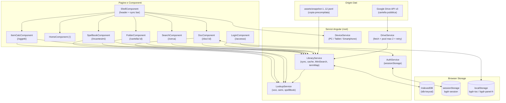

# Biblioteca GDR — Mini-Wiki Tecnica

> [!info] Cos'è questo progetto
> **Biblioteca GDR** (`biblioteca-gdr` v1.0.0) è una Single Page Application (SPA) responsive sviluppata in **Angular 20** (standalone components + Signals) che trasforma una cartella **Google Drive** contenente manuali e schede di gioco di ruolo (sistema *Kirthfinder* / Pathfinder 1e / D&D 3.5) in una biblioteca consultabile offline-first direttamente dal browser, con ricerca full-text, formule interattive degli incantesimi, auto-linking di talenti/feat, libro degli incantesimi per classe e calcolatore per la creazione di oggetti magici in *numen* e *gp*.

---

## Panoramica rapida

| Aspetto | Dettaglio |
|---|---|
| **Framework** | Angular 20 (`@angular/build:application`, standalone, Signals, `zone.js`) |
| **Linguaggio** | TypeScript ~5.8 (`strict: true`, target `ES2022`) |
| **Origine dati** | Google Drive API v3 (cartella pubblica `driveRootId`) + 12 file `snapshot-*.jsonl` precompilati (~151,6 MB, 636 documenti) |
| **Persistenza client** | IndexedDB tramite `idb-keyval` + `sessionStorage` (sessione) + `localStorage` (UI doc) |
| **Parsing documenti** | `mammoth` (`.docx` e Google Docs esportati come `.docx`) + parser DOM custom (`doc-parser.ts`) |
| **Motore di ricerca** | `MiniSearch` (in-memory, indicizzazione per sezione, separazione Regole vs Bestiario) |
| **Hosting** | Statico (GitHub Pages con GitHub Actions o Netlify Drop) con `withHashLocation()` |
| **Dataset inclusi nel repo** | 182 preset di oggetti (`ITEM_PRESETS`), 37 oggetti composti (`COMPOSITE_ITEMS`), 332 trucchi/spell del Ladro (`ROGUE_TRICKS`), 25 manovre Mano d'Ombra (`SHADOW_HAND`), 5 sfondi pergamena |

---

## Mappa della Wiki

### 01 — Architettura
- [[Stack e Configurazione]] — Dipendenze, `package.json`, `angular.json`, `tsconfig`, `environment.ts` e `typings.d.ts`.
- [[Routing, Layout e Auth]] — Bootstrap, rotte con hash location, `AuthService`, guardie, `ShellComponent` e rilevamento dispositivo (`DeviceService`).
- [[Flusso Dati e Cache]] — Pipeline completa: Google Drive API (`DriveService`), snapshot JSONL, cache IndexedDB, `LibraryService`, `mergeGroups` e sincronizzazione incrementale.
- [[Stile e Assets]] — Tema pergamena invecchiata (`styles.css`), variabili CSS, responsive, icone SVG (`IconComponent`) e risorse in `src/assets/`.

### 02 — Funzionalità
- [[Navigazione e Lettura Documenti]] — Home, esplorazione cartelle (`FolderComponent`), visualizzatore documenti (`DocComponent`), indice laterale (TOC) e pannello inferiore ridimensionabile.
- [[Ricerca e Bestiario]] — Motore di ricerca full-text (`SearchComponent`), ranking a 3 livelli, separazione del Bestiario e ricerca dedicata (`BestiarySearchComponent`).
- [[Parser, Formule Spell e Lookup]] — Arricchimento HTML (`doc-parser.ts`), riconoscimento formule/semi, risoluzione descrizioni (`LookupService`) e auto-linking dei termini (`term-links.ts`).
- [[Incantesimi per Classe]] — Costruzione dinamica delle liste (`SpellbookComponent`), liste statiche (`extra-lists.ts`), Mago + Mano d'Ombra, Ladro e ricerca online di fallback.
- [[Calcolatore Oggetti Magici]] — Formula *numen* e *gp* (`item-calc.ts`), scorta privata (`×18`), 182 preset (`item-presets.ts`), 37 oggetti composti (`item-composite.ts`) e interfaccia (`ItemCalcComponent`).

### 03 — Riferimento Tecnico
- [[Modelli Dati]] — Tutte le interfacce TypeScript (`models.ts` e tipi di dominio nei moduli), chiavi di storage (IndexedDB, `localStorage`, `sessionStorage`).
- [[Mappa Completa dei File]] — Inventario file-per-file del repository con responsabilità, simboli esportati e dipendenze.

### 04 — Operatività e Deploy
- [[Setup, Build e Deploy]] — Configurazione Google Cloud / Drive API, esecuzione locale, workflow GitHub Pages (`.github/workflows/pages.yml`), Netlify Drop e rigenerazione degli snapshot.

### 05 — Analisi e Manutenzione
- [[Sicurezza, Limiti e Debito Tecnico]] — Modello di sicurezza reale, bug/disallineamenti individuati nell'analisi del codice, debito tecnico e spunti evolutivi.

---

## Architettura ad alto livello

---

## Contenuto indicizzato nello snapshot attuale

Dall'intestazione di `src/assets/snapshot-1.jsonl` (`generatedAt: 2026-11-21T14:48:46.511Z`):

- **Radice**: `Biblioteca` (732 elementi non-cartella totali; **636 documenti** salvati nei 12 file JSONL per ~151,6 MB complessivi).
  - `Manuale` (699 doc):
    - `Bestiary` (666 doc — suddiviso per tipo/ambiente)
    - `Classes` (22 doc)
    - `Skills, Feats, etc` (10 doc — inclusi `Ch 4 Skills`, `Ch 5 Feats`, `Ch 6a Item Compendium`, `Ch 8 + 8a` uniti)
    - `Changelog` (`text`)
  - `Schede` (31 doc):
    - `Crew di Johhnny Boston` (22 doc)
    - `Miei PG` (4 doc)
    - 5 file vari (`kind: 'other'`)
  - File sciolti in radice: `Benvenuto` (`text`), `Kirthfinder_Referee_Screen_Corretto` (`other`).

> [!warning] Punti di attenzione residui
> Prima di pubblicare o modificare il progetto, consulta [[Sicurezza, Limiti e Debito Tecnico]]: in particolare la verifica/rotazione della chiave API nella cronologia Git, i limiti di sicurezza dell'autenticazione client-side e il peso degli snapshot nel repository.
