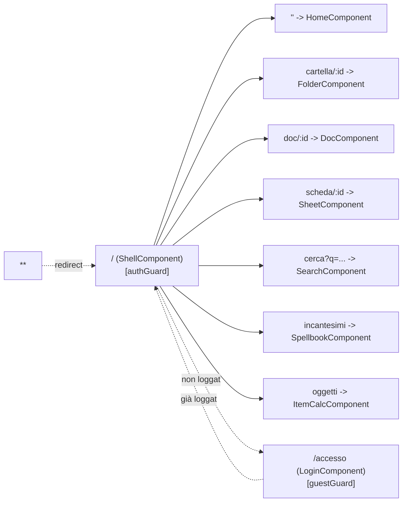

# Routing, Layout e Auth

Torna a [[00 - Indice (MOC)]] · Correlati: [[Stack e Configurazione]], [[Navigazione e Lettura Documenti]], [[Sicurezza, Limiti e Debito Tecnico]]

---

## Configurazione applicativa (`src/app/app.config.ts`, `src/app/app.component.ts`)

- `appConfig` registra due provider:
  1. `provideBrowserGlobalErrorListeners()` (Angular 20)
  2. `provideRouter(routes, withHashLocation())` — usa URL con frammento `#` (es. `/#/doc/12345`), così da funzionare su qualsiasi hosting statico (GitHub Pages, Netlify, apertura da sottocartella) senza regole server di fallback.
- `AppComponent` (`<app-root>`) renderizza unicamente `<router-outlet />` e inietta `DeviceService` affinché il rilevamento del dispositivo avvenga immediatamente all'apertura della pagina.

---

## Tabella delle rotte (`src/app/app.routes.ts`)

| Percorso (dopo `#/`) | Componente | Guardia | Query / Fragment | Descrizione |
|---|---|---|---|---|
| `/accesso` | `LoginComponent` | `guestGuard` | `?returnUrl=...` | Form di login (`admin` / `0000`) |
| `/` | `ShellComponent` → `HomeComponent` | `authGuard` | — | Dashboard con categorie, strumenti ed export snapshot |
| `/cartella/:id` | `ShellComponent` → `FolderComponent` | `authGuard` | — | Contenuto di una cartella (sottocartelle + file + ricerca bestiario se dentro Bestiary) |
| `/doc/:id` | `ShellComponent` → `DocComponent` | `authGuard` | `#s-N`, `#p0-N`, `#s-fN` | Lettore documenti con TOC, formule interattive e pannello descrizioni |
| `/scheda/:id` | `ShellComponent` → `SheetComponent` | `authGuard` | — | Scheda personaggio Google Sheets incorporata (`Solo lettura`, `Modifica`, checkbox `Mostra menu`) |
| `/cerca` | `ShellComponent` → `SearchComponent` | `authGuard` | `?q=...` | Ricerca full-text globale (esclude Bestiario) |
| `/incantesimi` | `ShellComponent` → `SpellbookComponent` | `authGuard` | — | Liste incantesimi per classe e livello |
| `/oggetti` | `ShellComponent` → `ItemCalcComponent` | `authGuard` | — | Calcolatore oggetti magici, alchimia e composti |
| `**` | redirect a `''` | — | — | Fallback verso Home (protetta da `authGuard`) |

---

## Autenticazione e Guardie (`auth.service.ts`, `auth.guard.ts`, `login.component.ts`)

### `AuthService`
- Credenziali hardcoded: `LOGIN_USER = 'admin'`, `LOGIN_PASS = '0000'` (`user.trim() === LOGIN_USER && pass === LOGIN_PASS`).
- Persistenza: `sessionStorage` con chiave `'bgdr-session'` = `'ok'` (dura per la singola scheda/sessione browser; racchiuso in `try/catch` in caso di storage bloccato).
- Stato reattivo: `readonly loggedIn = signal(readSession())`.

> [!danger] Barriera di comodo, non sicurezza reale
> Le credenziali sono in chiaro nel bundle JavaScript e la cartella Drive è condivisa con link pubblico. Vedi [[Sicurezza, Limiti e Debito Tecnico#Autenticazione client-side e chiave API]].

### Guardie funzionali (`auth.guard.ts`)
- **`authGuard`**: se `AuthService.loggedIn()` è `false`, reindirizza a `/accesso` passando `queryParams: { returnUrl: state.url }`.
- **`guestGuard`**: se `AuthService.loggedIn()` è `true`, impedisce di restare su `/accesso` e reindirizza a `/`.

### Flusso di Login (`LoginComponent`)
1. Valida credenziali via `auth.login(user, pass)`. Se errate, mostra avviso (`role="alert"`) e azzera `pass`.
2. Se valide, imposta `busy = true` e avvia `library.verify()` in `Promise.race` con un **timeout massimo di 15 secondi**:
   - Confronta la struttura del Drive con la cache (fase 1 veloce).
   - Gli eventuali download dei file modificati proseguono in background.
   - Se Drive non risponde entro 15 s, entra comunque usando la copia locale.
3. Sanitizza `returnUrl` (accetta solo percorsi che iniziano con `/` e non con `//` per evitare open redirect) e naviga con `router.navigateByUrl(safe)`.

---

## Layout principale (`ShellComponent`)

`ShellComponent` avvolge tutte le viste autenticate e nel costruttore invoca `void this.library.start()` (che carica la cache IndexedDB e lancia `verify()` solo se manca ancora l'albero).

Struttura del template:
1. **Header sticky (`.top`)**:
   - Brand link `Biblioteca GDR` → `/`
   - Form di ricerca globale (`role="search"`) → naviga a `/cerca?q=...` e fa `window.scrollTo({ top: 0 })`
   - Pulsante **Esci** (`logout()`)
2. **Barra di stato sincronizzazione (`.sync`)**:
   - Mostra `syncText()` (calcolato via `computed` da `status`, `fatalError`, `done`/`total`, `docErrors`, `lastCheck` in formato `HH:mm` `it-IT`). Assume la classe `.warn` in caso di errore.
   - Mostra a destra `Dispositivo: {{ device.label() }}`.
3. **Contenuto (`<main class="page">`)**: `<router-outlet />`.

### Flusso di Logout (`ShellComponent.logout()`)
1. Disabilita il pulsante (`leaving = true`, testo `"Controllo…"`).
2. Attende `Promise.race([this.library.verify(), timeout(15000)])` così da lasciare la copia locale aggiornata per la visita successiva.
3. Nel blocco `finally`: esegue `auth.logout()`, ripristina `leaving = false` e naviga a `/accesso`.

---

## Rilevamento del dispositivo (`device.ts`, `device.service.ts`)

`detectDevice(nav, screenSize)` classifica il client in `DeviceKind = 'smartphone' | 'tablet' | 'pc'` con etichette leggibili (`Smartphone`, `Tablet`, `PC / notebook`):

1. User-Agent con `iPad|Tablet|PlayBook|Silk|Kindle` → `tablet`
2. User-Agent `Macintosh` + `maxTouchPoints > 1` (iPadOS) → `tablet`
3. User-Agent `Android` → `smartphone` se contiene `Mobile`, altrimenti `tablet`
4. User-Agent `iPhone|iPod|Windows Phone|IEMobile|BlackBerry|Opera Mini` → `smartphone`
5. Fallback touch (`maxTouchPoints > 1`): lato corto `< 600` → `smartphone`; `< 1100` → `tablet`
6. Default → `pc`.

`DeviceService` esegue un `effect()` che scrive `document.documentElement.dataset['device'] = this.kind()` (`<html data-device="...">`).

> [!note] Uso effettivo di `data-device`
> Attualmente `styles.css` non definisce regole basate su `[data-device="..."]` ma usa media query CSS basate sulla viewport (`max-width: 600px` e `max-width: 899px`). Il valore del `DeviceService` è esposto visivamente in `LoginComponent` e `ShellComponent`.
