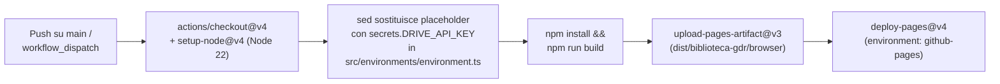

# Setup, Build e Deploy

Torna a [[00 - Indice (MOC)]] · Correlati: [[Stack e Configurazione]], [[Flusso Dati e Cache]], [[Sicurezza, Limiti e Debito Tecnico]]

---

## 1. Prerequisiti Google Drive e Google Cloud

1. **Cartella Google Drive**:
   - ID attualmente configurato in `src/environments/environment.ts`: `1zyULW02GoZhcXmsVODW0m4jaxsKIcHkB`.
   - Condivisione richiesta: *Generale → Chiunque abbia il link → Visualizzatore* (ereditata da tutte le sottocartelle).
2. **Chiave API Google**:
   - Su Google Cloud Console abilitare **Google Drive API**.
   - Creare una **Chiave API** (`AIza...`).
   - Applicare **Restrizioni per API**: solo *Google Drive API*.
   - Applicare **Restrizioni per applicazione (Siti web / HTTP Referrer)**:
     - `http://localhost:4200/*` (sviluppo locale)
     - `https://<utente>.github.io/*` e/o `https://<sito>.netlify.app/*` (produzione)

---

## 2. Sviluppo locale

Requisito: **Node.js LTS** (la CI utilizza Node 22).

```bash
npm install
```

Inserire temporaneamente la chiave API in `src/environments/environment.ts` al posto di `INSERISCI_QUI_LA_TUA_API_KEY` (**senza committarla su Git!**), quindi avviare:

```bash
npm start
```

- URL locale: `http://localhost:4200`
- Credenziali: `admin` / `0000`
- Build di produzione locale:
  ```bash
  npm run build
  ```
  Output pronto per hosting statico in `dist/biblioteca-gdr/browser`.

---

## 3. Deploy automatico su GitHub Pages (`.github/workflows/pages.yml`)

Il workflow **Pubblica su GitHub Pages** gira automaticamente su ogni `push` su `main` oppure manualmente via `workflow_dispatch`:



### Configurazione richiesta sul repository GitHub
1. **Settings → Secrets and variables → Actions**: creare il secret `DRIVE_API_KEY` con la chiave API Google.
2. **Settings → Pages → Source**: selezionare **GitHub Actions**.
3. **Concorrenza**: il workflow ha `concurrency: { group: pages, cancel-in-progress: true }`.

> [!warning] Attenzione al `sed` nel workflow
> Il passo `sed -i "s|INSERISCI_QUI_LA_TUA_API_KEY|${{ secrets.DRIVE_API_KEY }}|" src/environments/environment.ts` funziona **solo** se nel file committato su `main` è presente esattamente la stringa segnaposto `INSERISCI_QUI_LA_TUA_API_KEY`.

---

## 4. Deploy manuale alternativo (Netlify Drop)

1. Impostare `apiKey` in `src/environments/environment.ts` in locale.
2. Eseguire `npm run build`.
3. Trascinare la cartella `dist/biblioteca-gdr/browser` su `https://app.netlify.com/drop`.
4. Aggiungere l'URL Netlify alle restrizioni HTTP referrer della chiave API Google.

---

## 5. Aggiornamento della copia precompilata (Snapshot)

Le modifiche ai documenti sul Drive si propagano automaticamente ai client al successivo login/logout senza ricompilare il sito. Tuttavia, per velocizzare il primo avvio sui nuovi dispositivi, è possibile aggiornare periodicamente gli snapshot:

1. Aprire l'app su un browser già sincronizzato.
2. In Home aprire **Copia per il caricamento rapido** → cliccare **Scarica la copia**.
3. Il browser scaricherà `snapshot-1.jsonl`, `snapshot-2.jsonl`, … (max ~15 MB ciascuno).
4. Sostituire i file in `src/assets/` rimuovendo eventuali `snapshot-N.jsonl` in eccesso rispetto al nuovo conteggio (altrimenti `importSnapshot()` continuerebbe a scaricare vecchie partizioni!).
5. Committare e fare push su `main`.

> [!tip] Inclusione nel build
> `angular.json` include `"assets": ["src/assets"]`, quindi tutti i file `snapshot-*.jsonl` vengono copiati automaticamente in `dist/biblioteca-gdr/browser/assets/` al momento della compilazione.
